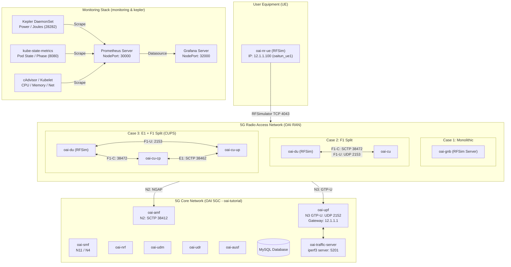

# Complete End-to-End Guide: Deploying OAI 5G Core, Multi-Split RAN, Observability (Prometheus & Grafana), and Automation Scripts from Scratch

This guide is a complete, self-contained, step-by-step engineering reference for deploying an end-to-end **OpenAirInterface (OAI) 5G Standalone (SA)** network on Kubernetes, integrating **Prometheus**, **Grafana**, and **Kepler (Energy Metrics)**, setting up **automated shell deployment scripts**, and executing **iperf3 throughput testing**.

---

## Table of Contents
1. [Architecture Overview](#1-architecture-overview)
2. [Prerequisites & System Preparation](#2-prerequisites--system-preparation)
3. [Cluster Setup (Kind / Kubernetes)](#3-cluster-setup-kind--kubernetes)
4. [Deploying the Observability Stack (Prometheus, Grafana, Kepler, KSM)](#4-deploying-the-observability-stack)
5. [Deploying the OAI 5G Core Network (5GC)](#5-deploying-the-oai-5g-core-network-5gc)
6. [Deploying 5G RAN Split Architectures (Cases 1, 2, 3)](#6-deploying-5g-ran-split-architectures)
7. [Automated Shell Scripts Suite](#7-automated-shell-scripts-suite)
8. [Traffic Generation (iperf3) & Grafana Verification](#8-traffic-generation-iperf3--grafana-verification)
9. [Troubleshooting & Common Pitfalls](#9-troubleshooting--common-pitfalls)

---

## 1. Architecture Overview



---

## 2. Prerequisites & System Preparation

### 2.1 Hardware Requirements
* **CPU:** 8+ Physical Cores (Intel/AMD x86_64) with AVX2 support.
* **RAM:** Minimum 16 GB (32 GB recommended).
* **Disk:** 50 GB free NVMe/SSD storage.
* **OS:** Linux (Ubuntu 22.04 LTS or 24.04 LTS).

### 2.2 Host Packages Installation
```bash
sudo apt update && sudo apt install -y \
    curl wget git jq apt-transport-https ca-certificates \
    gnupg lsb-release iperf3 net-tools iproute2 bridge-utils
```

### 2.3 Docker & Helm Installation
```bash
# Install Docker Engine
curl -fsSL https://get.docker.com | sudo sh
sudo usermod -aG docker $USER
newgrp docker

# Install Kubectl
curl -LO "https://dl.k8s.io/release/$(curl -L -s https://dl.k8s.io/release/stable.txt)/bin/linux/amd64/kubectl"
sudo install -o root -g root -m 0755 kubectl /usr/local/bin/kubectl

# Install Helm
curl https://raw.githubusercontent.com/helm/helm/main/scripts/get-helm-3 | bash

# Install Kind
curl -Lo ./kind https://kind.sigs.k8s.io/dl/v0.23.0/kind-linux-amd64
chmod +x ./kind
sudo mv ./kind /usr/local/bin/kind
```

### 2.4 Critical Kernel Sysctl Limits
> [!IMPORTANT]
> Kubernetes and Go-based daemons (`kube-proxy`, `coredns`, `local-path-provisioner`) require high `inotify` limits when running in containers or Kind. Without these, components crash with `too many open files`.

Add the following to `/etc/sysctl.conf`:
```ini
fs.inotify.max_user_watches = 524288
fs.inotify.max_user_instances = 8192
net.ipv4.ip_forward = 1
```
Apply immediately:
```bash
sudo sysctl -p
```

---

## 3. Cluster Setup (Kind / Kubernetes)

### 3.1 Create Kind Cluster Configuration (`kind-config.yaml`)
```yaml
kind: Cluster
apiVersion: kind.x-k8s.io/v1alpha4
name: oai-tutorial
nodes:
- role: control-plane
  image: kindest/node:v1.30.0
  extraPortMappings:
  - containerPort: 30000
    hostPort: 30000
    protocol: TCP   # Prometheus Web UI
  - containerPort: 32000
    hostPort: 32000
    protocol: TCP   # Grafana Web UI
```

Create the cluster:
```bash
kind create cluster --config kind-config.yaml
kubectl cluster-info --context kind-oai-tutorial
```

### 3.2 Prepare Namespaces
```bash
kubectl create namespace oai-tutorial
kubectl create namespace monitoring
kubectl create namespace kepler

# Relax pod security policies for telecom networking privileges
kubectl label --overwrite namespace oai-tutorial \
  pod-security.kubernetes.io/enforce=privileged \
  pod-security.kubernetes.io/warn=privileged \
  pod-security.kubernetes.io/audit=privileged
```

---

## 4. Deploying the Observability Stack

### 4.1 Deploy Kepler (Power / Energy Consumption Exporter)
Kepler uses Linux eBPF to monitor energy metrics per pod/container:
```bash
kubectl apply -f https://raw.githubusercontent.com/sustainable-computing-io/kepler/main/manifests/kubernetes/kepler/kepler.yaml -n kepler
```

### 4.2 Deploy kube-state-metrics (Pod Health & State Exporter)
```bash
kubectl apply -f https://raw.githubusercontent.com/kubernetes/kube-state-metrics/main/examples/standard/service-account.yaml
kubectl apply -f https://raw.githubusercontent.com/kubernetes/kube-state-metrics/main/examples/standard/cluster-role.yaml
kubectl apply -f https://raw.githubusercontent.com/kubernetes/kube-state-metrics/main/examples/standard/cluster-role-binding.yaml
kubectl apply -f https://raw.githubusercontent.com/kubernetes/kube-state-metrics/main/examples/standard/deployment.yaml
kubectl apply -f https://raw.githubusercontent.com/kubernetes/kube-state-metrics/main/examples/standard/service.yaml
```

### 4.3 Configure & Deploy Prometheus

#### 1. Prometheus Scrape Configuration (`prometheus-cm.yaml`)
Create the ConfigMap so Prometheus discovers pods, cAdvisor, and Kepler:
```yaml
apiVersion: v1
kind: ConfigMap
metadata:
  name: prometheus-server-conf
  namespace: monitoring
data:
  prometheus.yml: |
    global:
      scrape_interval: 5s
      evaluation_interval: 5s
    scrape_configs:
      - job_name: 'kubernetes-cadvisor'
        scheme: https
        tls_config:
          ca_file: /var/run/secrets/kubernetes.io/serviceaccount/ca.crt
        bearer_token_file: /var/run/secrets/kubernetes.io/serviceaccount/token
        kubernetes_sd_configs:
        - role: node
        relabel_configs:
        - target_label: __address__
          replacement: kubernetes.default.svc:443
        - source_labels: [__meta_kubernetes_node_name]
          regex: (.+)
          target_label: __metrics_path__
          replacement: /api/v1/nodes/${1}/proxy/metrics/cadvisor

      - job_name: 'kube-state-metrics'
        static_configs:
          - targets: ['kube-state-metrics.kube-system.svc.cluster.local:8080']

      - job_name: 'kepler'
        static_configs:
          - targets: ['kepler.kepler.svc.cluster.local:28282']

      - job_name: 'kubernetes-pods'
        kubernetes_sd_configs:
        - role: pod
        relabel_configs:
        - source_labels: [__meta_kubernetes_pod_annotation_prometheus_io_scrape]
          action: keep
          regex: true
```
Apply: `kubectl apply -f prometheus-cm.yaml`

#### 2. Deploy Prometheus Server
```yaml
apiVersion: apps/v1
kind: Deployment
metadata:
  name: prometheus-deployment
  namespace: monitoring
spec:
  replicas: 1
  selector:
    matchLabels:
      app: prometheus-server
  template:
    metadata:
      labels:
        app: prometheus-server
    spec:
      serviceAccountName: default
      containers:
      - name: prometheus
        image: prom/prometheus:v2.51.0
        args:
          - "--config.file=/etc/prometheus/prometheus.yml"
          - "--storage.tsdb.path=/prometheus/"
        ports:
          - containerPort: 9090
        volumeMounts:
          - name: config-volume
            mountPath: /etc/prometheus
      volumes:
        - name: config-volume
          configMap:
            name: prometheus-server-conf
---
apiVersion: v1
kind: Service
metadata:
  name: prometheus-service
  namespace: monitoring
spec:
  type: NodePort
  selector:
    app: prometheus-server
  ports:
    - port: 8080
      targetPort: 9090
      nodePort: 30000
```
Apply: `kubectl apply -f prometheus-deploy.yaml`

### 4.4 Configure & Deploy Grafana

#### 1. Provision Prometheus Datasource ConfigMap
```yaml
apiVersion: v1
kind: ConfigMap
metadata:
  name: grafana-datasources
  namespace: monitoring
data:
  prometheus.yaml: |
    apiVersion: 1
    datasources:
      - name: prometheus
        type: prometheus
        access: proxy
        url: http://prometheus-service.monitoring.svc:8080
        isDefault: true
        editable: true
```
Apply: `kubectl apply -f grafana-datasources-cm.yaml`

#### 2. Provision Dashboard Provider ConfigMap
```yaml
apiVersion: v1
kind: ConfigMap
metadata:
  name: grafana-dashboards-provider
  namespace: monitoring
data:
  dashboards.yaml: |
    apiVersion: 1
    providers:
    - name: '5G-Network-Dashboards'
      orgId: 1
      folder: '5G Network'
      type: file
      editable: true
      options:
        path: /etc/grafana/provisioning/dashboards/custom
```
Apply: `kubectl apply -f grafana-provider-cm.yaml`

#### 3. Deploy Grafana Server
```yaml
apiVersion: apps/v1
kind: Deployment
metadata:
  name: grafana
  namespace: monitoring
spec:
  replicas: 1
  selector:
    matchLabels:
      app: grafana
  template:
    metadata:
      labels:
        app: grafana
    spec:
      containers:
      - name: grafana
        image: grafana/grafana:latest
        ports:
          - containerPort: 3000
        env:
          - name: GF_SECURITY_ADMIN_USER
            value: admin
          - name: GF_SECURITY_ADMIN_PASSWORD
            value: admin
        volumeMounts:
          - mountPath: /etc/grafana/provisioning/datasources
            name: grafana-datasources
          - mountPath: /etc/grafana/provisioning/dashboards
            name: grafana-dashboards-provider
          - mountPath: /etc/grafana/provisioning/dashboards/custom
            name: grafana-k8s-pod-dashboard
      volumes:
        - name: grafana-datasources
          configMap:
            name: grafana-datasources
        - name: grafana-dashboards-provider
          configMap:
            name: grafana-dashboards-provider
        - name: grafana-k8s-pod-dashboard
          configMap:
            name: grafana-k8s-pod-dashboard
---
apiVersion: v1
kind: Service
metadata:
  name: grafana
  namespace: monitoring
spec:
  type: NodePort
  selector:
    app: grafana
  ports:
    - port: 3000
      targetPort: 3000
      nodePort: 32000
```
Apply: `kubectl apply -f grafana-deploy.yaml`

---

## 5. Deploying the OAI 5G Core Network (5GC)

Clone the official OAI Helm charts repository:
```bash
git clone https://gitlab.eurecom.fr/oai/cn5g/oai-cn5g-fed.git ~/oai-cn5g-fed
cd ~/oai-cn5g-fed/charts/oai-5g-core
```

Deploy the basic 5G Core functions (MySQL, NRF, UDR, UDM, AUSF, AMF, SMF, UPF, and Traffic Server):
```bash
helm install basic ~/oai-cn5g-fed/charts/oai-5g-core/oai-5g-basic -n oai-tutorial
```

Verify all 5G Core pods reach `1/1 Running`:
```bash
kubectl get pods -n oai-tutorial
```
Expected output:
* `basic-mysql-...` (1/1 Running)
* `oai-nrf-...` (1/1 Running)
* `oai-udr-...` (1/1 Running)
* `oai-udm-...` (1/1 Running)
* `oai-ausf-...` (1/1 Running)
* `oai-amf-...` (1/1 Running)
* `oai-smf-...` (1/1 Running)
* `oai-upf-...` (1/1 Running)
* `oai-traffic-server-...` (1/1 Running)

---

## 6. Deploying 5G RAN Split Architectures

The RAN charts are located under `~/deplo/charts/oai-5g-ran/`.

### Case 1: Monolithic gNodeB (RFSim Mode)
In this case, one monolithic gNB performs L1-L3 processing and connects to Core:
1. **gNB connects to AMF (N2 NGAP: SCTP 38412) & UPF (N3 GTP-U: UDP 2152)**:
   ```bash
   helm install gnb ~/deplo/charts/oai-5g-ran/oai-gnb -n oai-tutorial
   ```
2. **UE attaches via RFSimulator and establishes GTP tunnel**:
   ```bash
   helm install nrue ~/deplo/charts/oai-5g-ran/oai-nr-ue -n oai-tutorial --set config.rfSimServer=oai-ran
   ```

---

### Case 2: F1 Split (Central Unit + Distributed Unit)
In this case, the radio stack is split over the **F1 3GPP interface**:
* **CU (Central Unit)**: RRC + PDCP (High-layer protocol). Connects to AMF via N2 and UPF via N3.
* **DU (Distributed Unit)**: RLC + MAC + High PHY. Connects to CU over F1-C (SCTP 38472) and F1-U (UDP 2153).

1. **Deploy CU**:
   ```bash
   helm install cu ~/deplo/charts/oai-5g-ran/oai-cu -n oai-tutorial
   ```
2. **Deploy DU (pointing to CU)**:
   ```bash
   helm install du ~/deplo/charts/oai-5g-ran/oai-du -n oai-tutorial --set config.cuHost=oai-cu
   ```
3. **Deploy UE (pointing to DU RFSimulator IP)**:
   ```bash
   DU_IP=$(kubectl get pod -n oai-tutorial -l app.kubernetes.io/name=oai-du -o jsonpath='{.items[0].status.podIP}')
   helm install nrue ~/deplo/charts/oai-5g-ran/oai-nr-ue -n oai-tutorial --set config.rfSimServer=$DU_IP
   ```

---

### Case 3: CUPS / E1-F1 Split (Control and User Plane Separation)
In this case:
* **CU-CP**: Handles Control Plane (RRC + PDCP-C).
* **CU-UP**: Handles User Plane (PDCP-U). Connects to CU-CP over E1 (SCTP 38462) and UPF over N3 GTP-U.
* **DU**: Connects F1-C to CU-CP and F1-U to CU-UP.

1. **Deploy CU-CP**:
   ```bash
   helm install cucp ~/deplo/charts/oai-5g-ran/oai-cu-cp -n oai-tutorial
   ```
2. **Deploy CU-UP (connects E1 to CU-CP)**:
   ```bash
   helm install cuup ~/deplo/charts/oai-5g-ran/oai-cu-up -n oai-tutorial --set config.cucpHost=oai-cu-cp
   ```
3. **Deploy DU (connects F1 to CU-CP / CU-UP)**:
   ```bash
   helm install du ~/deplo/charts/oai-5g-ran/oai-du -n oai-tutorial --set config.cuHost=oai-cu-cp
   ```
4. **Deploy UE**:
   ```bash
   DU_IP=$(kubectl get pod -n oai-tutorial -l app.kubernetes.io/name=oai-du -o jsonpath='{.items[0].status.podIP}')
   helm install nrue ~/deplo/charts/oai-5g-ran/oai-nr-ue -n oai-tutorial --set config.rfSimServer=$DU_IP
   ```

---

## 7. Automated Shell Scripts Suite

All automated workflows are located in `/home/snsrl/scripts/`.

### Directory Tree
```text
/home/snsrl/scripts/
├── common.sh                             # Shared library (context, namespace, wait helpers)
├── status_all.sh                         # Master diagnostic for Core, RAN, UE tunnel & Helm
│
├── case1_monolithic/
│   ├── 01_connect_gnb_to_upf.sh          # gNB to Core & GTP interface
│   ├── 02_connect_ue_to_gnb_and_gtp.sh   # Attach UE & test tunnel
│   ├── run_case1.sh                      # Full Case 1 runner
│   └── cleanup_case1.sh                  # Case 1 teardown
│
├── case2_f1_split/
│   ├── 01_connect_cu_to_core.sh          # CU to Core
│   ├── 02_connect_cu_and_du.sh           # DU to CU over F1
│   ├── 03_connect_du_to_upf.sh           # DU to UPF data plane check
│   ├── 04_connect_ue_to_cu_and_gtp.sh    # UE to DU/CU & verify tunnel
│   ├── run_case2.sh                      # Full Case 2 runner
│   └── cleanup_case2.sh                  # Case 2 teardown
│
└── case3_cups/
    ├── 01_connect_cu_cp_to_amf.sh        # CU-CP to AMF (N2)
    ├── 02_connect_cu_cp_and_cu_up.sh     # CU-UP to CU-CP (E1)
    ├── 03_connect_cu_up_to_upf.sh        # CU-UP to UPF (N3)
    ├── 04_connect_cu_and_du.sh           # DU to CU-CP & CU-UP (F1)
    ├── 05_connect_ue_and_gtp_tunnel.sh   # UE to DU & CUPS tunnel
    ├── run_case3.sh                      # Full Case 3 runner
    └── cleanup_case3.sh                  # Case 3 teardown
```

### Execution Example
```bash
# Check overall cluster status
/home/snsrl/scripts/status_all.sh

# Run Case 2 automated deployment
/home/snsrl/scripts/case2_f1_split/run_case2.sh

# Teardown Case 2 when finished
/home/snsrl/scripts/case2_f1_split/cleanup_case2.sh
```

---

## 8. Traffic Generation (iperf3) & Grafana Verification

### 8.1 The Execution Rule
> [!CAUTION]
> Do NOT run `iperf3 -c ... -B 12.1.1.100` on your host prompt (`snsrl@snsrl`). The IP `12.1.1.100` is the 5G tunnel interface inside the UE container. Running it on the host will cause:  
> `iperf3: error - unable to send control message: Bad file descriptor`.

### 8.2 Proper Traffic Command
Execute `iperf3` directly inside the UE container via `kubectl exec`:

```bash
# Uplink test: 25 Mbps for 30 seconds
UE_POD=$(kubectl get pod -n oai-tutorial -l app.kubernetes.io/name=oai-nr-ue -o jsonpath='{.items[0].metadata.name}')

kubectl exec -it -n oai-tutorial $UE_POD -c nr-ue -- \
  iperf3 -c 10.244.0.19 -p 5201 -B 12.1.1.100 -u -b 25M -t 30
```

### 8.3 Observing Live Metrics in Grafana

1. Open Grafana:
   * **Direct URL:** `http://172.21.0.2:32000` (or `http://10.230.4.28:3000` with port-forward).
   * **Login:** `admin` / `admin`.
2. Open **Dashboards → `5G Network` → `Case 2: CU-DU F1 Split 5G & Kepler Energy Monitoring`**.
3. Real-time changes to observe during traffic:
   * **F1 Interface & UPF Data Throughput:** Graph spikes to ~25 Mbps.
   * **Central Unit (CU) & Distributed Unit (DU) CPU Load:** Shows real-time CPU consumption during physical/PDCP layer processing.
   * **Kepler Container Power Consumption (Watts):** Real-time wattage surge for `du` and `upf` containers.

---

## 9. Troubleshooting & Common Pitfalls

| Issue | Cause | Solution |
| :--- | :--- | :--- |
| **`too many open files` in `kube-proxy` / `coredns`** | Linux kernel inotify instance exhaustion in container environments. | Set `sysctl -w fs.inotify.max_user_instances=8192` on the host and restart the failing pods. |
| **Kubelet CrashLoop (`cpu_manager_state`)** | Kubelet static CPU manager policy conflict between reserved CPUs and stale cache. | Remove stale file: `docker exec <node> rm -f /var/lib/kubelet/cpu_manager_state` and restart kubelet. |
| **`iperf3: Bad file descriptor`** | Attempting to bind (`-B 12.1.1.100`) on the host rather than inside the UE container. | Run the command inside the UE pod using `kubectl exec -it <ue-pod> -c nr-ue -- ...`. |
| **`Unknown hostname` in init containers** | CoreDNS was unable to reach API server or restart was required. | Restart CoreDNS: `kubectl rollout restart deploy/coredns -n kube-system`. |
| **Overlapping RAN Pods** | Running Case 1 and Case 2 at the same time in the same namespace causes RFSimulator socket clashes. | Always run the corresponding `cleanup_caseX.sh` before switching to another architecture. |
