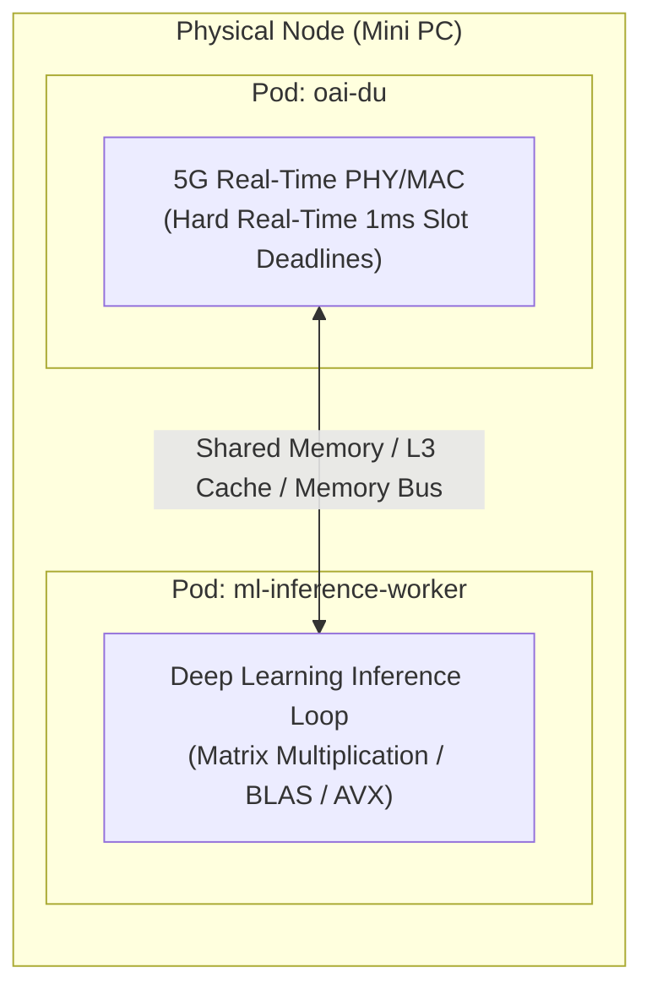

# Complete Runbook: New Mini PC Setup for OAI 5G (Cases 1, 2, 3), Observability, and Co-located AI/ML Inference Workload (Scenario 2)

This documentation provides an end-to-end, copy-pasteable installation and operation guide for setting up a brand-new Mini PC (e.g., Intel NUC, AMD Ryzen Mini PC, or edge workstation) from bare-metal Ubuntu to an active OpenAirInterface (OAI) 5G network integrated with Prometheus, Grafana, Kepler, and a separate, co-located AI/ML Inference Pod to test and analyze physical CPU core contention.

---

## Table of Contents
1. [Mini PC Bare-Metal & OS Preparation](#1-mini-pc-bare-metal--os-preparation)
2. [Docker, Kind, and Kubernetes Tooling Installation](#2-docker-kind-and-kubernetes-tooling-installation)
3. [Kind Cluster Creation (Optimized for 5G & CPU Isolation)](#3-kind-cluster-creation-optimized-for-5g--cpu-isolation)
4. [Observability Stack Setup (Prometheus, Grafana, Kepler, KSM)](#4-observability-stack-setup-prometheus-grafana-kepler-ksm)
5. [OAI 5G Core Network Deployment](#5-oai-5g-core-network-deployment)
6. [The 3 5G RAN Split Architectures (Case 1, Case 2, Case 3)](#6-the-3-5g-ran-split-architectures)
7. [Scenario 2: Implementing the Co-located AI/ML Inference Pod](#7-scenario-2-implementing-the-co-located-aiml-inference-pod)
8. [End-to-End CPU Core Contention Experiment & Verification](#8-end-to-end-cpu-core-contention-experiment--verification)
9. [Troubleshooting & Quick Reference](#9-troubleshooting--quick-reference)

---

## 1. Mini PC Bare-Metal & OS Preparation

### 1.1 BIOS / UEFI Settings (Hardware Tuning)
Reboot into the Mini PC BIOS (usually `F2`, `F10`, or `Del`) and verify:
* **Intel VT-x / AMD-V:** `Enabled` (Required for containers and nested virtualization).
* **Intel SpeedStep / AMD Cool'n'Quiet:** `Disabled` or set to `Maximum Performance` (Prevents CPU clock jitter during 5G slot deadlines).
* **C-States / Deep Sleep:** Set to `C0/C1` only or `High Performance Mode` (Prevents CPU sleep states from dropping packets).

### 1.2 OS & Kernel Dependencies
Install **Ubuntu 22.04 LTS (Jammy Jellyfish)** or **Ubuntu 24.04 LTS**.

Open a terminal and install core packages:
```bash
sudo apt update && sudo apt upgrade -y
sudo apt install -y \
    curl wget git jq apt-transport-https ca-certificates gnupg \
    lsb-release iperf3 net-tools iproute2 bridge-utils bsdmainutils \
    build-essential htop iotop linux-tools-common
```

### 1.3 Critical Kernel Parameters & Sysctls
> [!IMPORTANT]
> Kubernetes and containerized CNI components exhaust inotify handles and will fail with `too many open files` unless limits are increased.

Run the following commands:
```bash
sudo bash -c 'cat <<EOF >> /etc/sysctl.conf
# 5G & Kubernetes Kernel Tuning
fs.inotify.max_user_watches = 524288
fs.inotify.max_user_instances = 8192
net.ipv4.ip_forward = 1
net.core.rmem_max = 67108864
net.core.wmem_max = 67108864
net.core.rmem_default = 67108864
net.core.wmem_default = 67108864
EOF'

sudo sysctl -p
```

---

## 2. Docker, Kind, and Kubernetes Tooling Installation

Run this block to install Docker, Kubectl, Helm, and Kind:

```bash
# 1. Install Docker Engine
curl -fsSL https://get.docker.com | sudo sh
sudo usermod -aG docker $USER

# 2. Install Kubectl
curl -LO "https://dl.k8s.io/release/$(curl -L -s https://dl.k8s.io/release/stable.txt)/bin/linux/amd64/kubectl"
sudo install -o root -g root -m 0755 kubectl /usr/local/bin/kubectl

# 3. Install Helm 3
curl https://raw.githubusercontent.com/helm/helm/main/scripts/get-helm-3 | bash

# 4. Install Kind (Kubernetes in Docker)
curl -Lo ./kind https://kind.sigs.k8s.io/dl/v0.23.0/kind-linux-amd64
chmod +x ./kind
sudo mv ./kind /usr/local/bin/kind

# Verify installations
docker --version && kubectl version --client && helm version && kind version
```

Log out and log back in, or run `newgrp docker` to apply group permissions.

---

## 3. Kind Cluster Creation (Optimized for 5G & CPU Isolation)

Create a dedicated Kind cluster configuration file:

```bash
cat <<EOF > ~/kind-5g-config.yaml
kind: Cluster
apiVersion: kind.x-k8s.io/v1alpha4
name: oai-tutorial
nodes:
- role: control-plane
  image: kindest/node:v1.30.0
  extraPortMappings:
  - containerPort: 30000
    hostPort: 30000
    protocol: TCP   # Prometheus Web UI
  - containerPort: 32000
    hostPort: 32000
    protocol: TCP   # Grafana Web UI
  kubeadmConfigPatches:
  - |
    kind: KubeletConfiguration
    # Enables static CPU manager policy for pinned real-time cores
    cpuManagerPolicy: none
    failSwapOn: false
EOF
```

Spin up the cluster:
```bash
kind create cluster --config ~/kind-5g-config.yaml
kubectl cluster-info --context kind-oai-tutorial
```

Create and configure the required namespaces:
```bash
kubectl create namespace oai-tutorial
kubectl create namespace monitoring
kubectl create namespace kepler

# Enable privileged execution for telecom raw sockets
kubectl label --overwrite namespace oai-tutorial \
  pod-security.kubernetes.io/enforce=privileged \
  pod-security.kubernetes.io/warn=privileged \
  pod-security.kubernetes.io/audit=privileged
```

---

## 4. Observability Stack Setup (Prometheus, Grafana, Kepler, KSM)

### 4.1 Deploy Kepler (eBPF Energy & Power Exporter)
Kepler exposes per-pod and per-core energy metrics (Watts and Joules) on port `28282`:
```bash
kubectl apply -f https://raw.githubusercontent.com/sustainable-computing-io/kepler/main/manifests/kubernetes/kepler/kepler.yaml -n kepler
```

### 4.2 Deploy kube-state-metrics (KSM)
KSM exposes pod states and phases on port `8080`:
```bash
kubectl apply -f https://raw.githubusercontent.com/kubernetes/kube-state-metrics/main/examples/standard/service-account.yaml
kubectl apply -f https://raw.githubusercontent.com/kubernetes/kube-state-metrics/main/examples/standard/cluster-role.yaml
kubectl apply -f https://raw.githubusercontent.com/kubernetes/kube-state-metrics/main/examples/standard/cluster-role-binding.yaml
kubectl apply -f https://raw.githubusercontent.com/kubernetes/kube-state-metrics/main/examples/standard/deployment.yaml
kubectl apply -f https://raw.githubusercontent.com/kubernetes/kube-state-metrics/main/examples/standard/service.yaml
```

### 4.3 Deploy Prometheus Server
Create the scrape configuration ConfigMap:
```bash
cat <<EOF > ~/prometheus-cm.yaml
apiVersion: v1
kind: ConfigMap
metadata:
  name: prometheus-server-conf
  namespace: monitoring
data:
  prometheus.yml: |
    global:
      scrape_interval: 5s
      evaluation_interval: 5s
    scrape_configs:
      - job_name: 'kubernetes-cadvisor'
        scheme: https
        tls_config:
          ca_file: /var/run/secrets/kubernetes.io/serviceaccount/ca.crt
        bearer_token_file: /var/run/secrets/kubernetes.io/serviceaccount/token
        kubernetes_sd_configs:
        - role: node
        relabel_configs:
        - target_label: __address__
          replacement: kubernetes.default.svc:443
        - source_labels: [__meta_kubernetes_node_name]
          regex: (.+)
          target_label: __metrics_path__
          replacement: /api/v1/nodes/\${1}/proxy/metrics/cadvisor

      - job_name: 'kube-state-metrics'
        static_configs:
          - targets: ['kube-state-metrics.kube-system.svc.cluster.local:8080']

      - job_name: 'kepler'
        static_configs:
          - targets: ['kepler.kepler.svc.cluster.local:28282']

      - job_name: 'kubernetes-pods'
        kubernetes_sd_configs:
        - role: pod
        relabel_configs:
        - source_labels: [__meta_kubernetes_pod_annotation_prometheus_io_scrape]
          action: keep
          regex: true
EOF
kubectl apply -f ~/prometheus-cm.yaml
```

Deploy Prometheus Deployment and NodePort Service:
```bash
cat <<EOF > ~/prometheus-deploy.yaml
apiVersion: apps/v1
kind: Deployment
metadata:
  name: prometheus-deployment
  namespace: monitoring
spec:
  replicas: 1
  selector:
    matchLabels:
      app: prometheus-server
  template:
    metadata:
      labels:
        app: prometheus-server
    spec:
      serviceAccountName: default
      containers:
      - name: prometheus
        image: prom/prometheus:v2.51.0
        args:
          - "--config.file=/etc/prometheus/prometheus.yml"
          - "--storage.tsdb.path=/prometheus/"
        ports:
          - containerPort: 9090
        volumeMounts:
          - name: config-volume
            mountPath: /etc/prometheus
      volumes:
        - name: config-volume
          configMap:
            name: prometheus-server-conf
---
apiVersion: v1
kind: Service
metadata:
  name: prometheus-service
  namespace: monitoring
spec:
  type: NodePort
  selector:
    app: prometheus-server
  ports:
    - port: 8080
      targetPort: 9090
      nodePort: 30000
EOF
kubectl apply -f ~/prometheus-deploy.yaml
```

### 4.4 Deploy Grafana Server
Provision datasources and dashboard providers:
```bash
# 1. Datasource ConfigMap
cat <<EOF | kubectl apply -f -
apiVersion: v1
kind: ConfigMap
metadata:
  name: grafana-datasources
  namespace: monitoring
data:
  prometheus.yaml: |
    apiVersion: 1
    datasources:
      - name: prometheus
        type: prometheus
        access: proxy
        url: http://prometheus-service.monitoring.svc:8080
        isDefault: true
        editable: true
EOF

# 2. Dashboard Provider ConfigMap
cat <<EOF | kubectl apply -f -
apiVersion: v1
kind: ConfigMap
metadata:
  name: grafana-dashboards-provider
  namespace: monitoring
data:
  dashboards.yaml: |
    apiVersion: 1
    providers:
    - name: '5G-Network-Dashboards'
      orgId: 1
      folder: '5G Network'
      type: file
      editable: true
      options:
        path: /etc/grafana/provisioning/dashboards/custom
EOF
```

Deploy Grafana Deployment and NodePort Service:
```bash
cat <<EOF | kubectl apply -f -
apiVersion: apps/v1
kind: Deployment
metadata:
  name: grafana
  namespace: monitoring
spec:
  replicas: 1
  selector:
    matchLabels:
      app: grafana
  template:
    metadata:
      labels:
        app: grafana
    spec:
      containers:
      - name: grafana
        image: grafana/grafana:latest
        ports:
          - containerPort: 3000
        env:
          - name: GF_SECURITY_ADMIN_USER
            value: admin
          - name: GF_SECURITY_ADMIN_PASSWORD
            value: admin
        volumeMounts:
          - mountPath: /etc/grafana/provisioning/datasources
            name: grafana-datasources
          - mountPath: /etc/grafana/provisioning/dashboards
            name: grafana-dashboards-provider
      volumes:
        - name: grafana-datasources
          configMap:
            name: grafana-datasources
        - name: grafana-dashboards-provider
          configMap:
            name: grafana-dashboards-provider
---
apiVersion: v1
kind: Service
metadata:
  name: grafana
  namespace: monitoring
spec:
  type: NodePort
  selector:
    app: grafana
  ports:
    - port: 3000
      targetPort: 3000
      nodePort: 32000
EOF
```

---

## 5. OAI 5G Core Network Deployment

Clone the OAI repositories:
```bash
mkdir -p ~/deplo
git clone https://gitlab.eurecom.fr/oai/cn5g/oai-cn5g-fed.git ~/deplo/oai-cn5g-fed
cd ~/deplo/oai-cn5g-fed/charts/oai-5g-core
```

Deploy the basic 5G Core (MySQL, NRF, UDR, UDM, AUSF, AMF, SMF, UPF, and Traffic Server):
```bash
helm install basic ~/deplo/oai-cn5g-fed/charts/oai-5g-core/oai-5g-basic -n oai-tutorial
```

Wait until all 5G Core pods reach `Running` state:
```bash
kubectl wait --for=condition=ready pod -l app.kubernetes.io/name=oai-amf -n oai-tutorial --timeout=5m
kubectl wait --for=condition=ready pod -l app.kubernetes.io/name=oai-upf -n oai-tutorial --timeout=5m
kubectl get pods -n oai-tutorial
```

---

## 6. The 3 5G RAN Split Architectures

The RAN charts are located under `~/deplo/charts/oai-5g-ran/`. Clone them if you are on a fresh Mini PC:
```bash
git clone https://gitlab.eurecom.fr/oai/openairinterface5g.git ~/openairinterface5g
cp -r ~/openairinterface5g/charts/oai-5g-ran ~/deplo/charts/oai-5g-ran
```

> [!WARNING]
> Only deploy **ONE** case at a time in the same namespace to prevent RFSimulator port conflicts (`TCP:4043`). Always run the cleanup commands before switching cases.

---

### Case 1: Monolithic gNodeB (RFSimulator)
In Case 1, a single monolithic gNB performs all L1, L2, and L3 radio functions.

1. **Deploy gNB**:
   ```bash
   helm install gnb ~/deplo/charts/oai-5g-ran/oai-gnb -n oai-tutorial
   kubectl wait --for=condition=ready pod -l app.kubernetes.io/name=oai-gnb -n oai-tutorial --timeout=3m
   ```
2. **Deploy UE (Attaches to gNB)**:
   ```bash
   helm install nrue ~/deplo/charts/oai-5g-ran/oai-nr-ue -n oai-tutorial --set config.rfSimServer=oai-ran
   kubectl wait --for=condition=ready pod -l app.kubernetes.io/name=oai-nr-ue -n oai-tutorial --timeout=3m
   ```
3. **Verify GTP Tunnel**:
   ```bash
   kubectl exec -it -n oai-tutorial deploy/nrue -c nr-ue -- ping -c 3 -I oaitun_ue1 12.1.1.1
   ```
4. **Cleanup Case 1**:
   ```bash
   helm uninstall nrue gnb -n oai-tutorial
   ```

---

### Case 2: F1 Split (Central Unit + Distributed Unit)
In Case 2, higher layers (RRC/PDCP) run on the **CU**, while real-time time-critical layers (RLC/MAC/High-PHY) run on the **DU**.

1. **Deploy CU (N2 to AMF, N3 to UPF)**:
   ```bash
   helm install cu ~/deplo/charts/oai-5g-ran/oai-cu -n oai-tutorial
   kubectl wait --for=condition=ready pod -l app.kubernetes.io/name=oai-cu -n oai-tutorial --timeout=3m
   ```
2. **Deploy DU (Connects F1-C / F1-U to CU)**:
   ```bash
   helm install du ~/deplo/charts/oai-5g-ran/oai-du -n oai-tutorial --set config.cuHost=oai-cu
   kubectl wait --for=condition=ready pod -l app.kubernetes.io/name=oai-du -n oai-tutorial --timeout=3m
   ```
3. **Deploy UE (Connects RFSimulator to DU)**:
   ```bash
   DU_IP=$(kubectl get pod -n oai-tutorial -l app.kubernetes.io/name=oai-du -o jsonpath='{.items[0].status.podIP}')
   helm install nrue ~/deplo/charts/oai-5g-ran/oai-nr-ue -n oai-tutorial --set config.rfSimServer=$DU_IP
   kubectl wait --for=condition=ready pod -l app.kubernetes.io/name=oai-nr-ue -n oai-tutorial --timeout=3m
   ```
4. **Verify GTP Tunnel**:
   ```bash
   kubectl exec -it -n oai-tutorial deploy/nrue -c nr-ue -- ping -c 3 -I oaitun_ue1 12.1.1.1
   ```
5. **Cleanup Case 2**:
   ```bash
   helm uninstall nrue du cu -n oai-tutorial
   ```

---

### Case 3: CUPS / E1 + F1 Split (Control & User Plane Separation)
In Case 3, the CU is disaggregated into **CU-CP** (Control Plane) and **CU-UP** (User Plane) connected via **E1**.

1. **Deploy CU-CP (RRC & Control Signaling)**:
   ```bash
   helm install cucp ~/deplo/charts/oai-5g-ran/oai-cu-cp -n oai-tutorial
   kubectl wait --for=condition=ready pod -l app.kubernetes.io/name=oai-cu-cp -n oai-tutorial --timeout=3m
   ```
2. **Deploy CU-UP (User Plane & N3 GTP Tunnel)**:
   ```bash
   helm install cuup ~/deplo/charts/oai-5g-ran/oai-cu-up -n oai-tutorial --set config.cucpHost=oai-cu-cp
   kubectl wait --for=condition=ready pod -l app.kubernetes.io/name=oai-cu-up -n oai-tutorial --timeout=3m
   ```
3. **Deploy DU (F1-C to CU-CP, F1-U to CU-UP)**:
   ```bash
   helm install du ~/deplo/charts/oai-5g-ran/oai-du -n oai-tutorial --set config.cuHost=oai-cu-cp
   kubectl wait --for=condition=ready pod -l app.kubernetes.io/name=oai-du -n oai-tutorial --timeout=3m
   ```
4. **Deploy UE**:
   ```bash
   DU_IP=$(kubectl get pod -n oai-tutorial -l app.kubernetes.io/name=oai-du -o jsonpath='{.items[0].status.podIP}')
   helm install nrue ~/deplo/charts/oai-5g-ran/oai-nr-ue -n oai-tutorial --set config.rfSimServer=$DU_IP
   kubectl wait --for=condition=ready pod -l app.kubernetes.io/name=oai-nr-ue -n oai-tutorial --timeout=3m
   ```
5. **Verify GTP Tunnel**:
   ```bash
   kubectl exec -it -n oai-tutorial deploy/nrue -c nr-ue -- ping -c 3 -I oaitun_ue1 12.1.1.1
   ```
6. **Cleanup Case 3**:
   ```bash
   helm uninstall nrue du cuup cucp -n oai-tutorial
   ```

---

## 7. Scenario 2: Implementing the Co-located AI/ML Inference Pod

Scenario 2 places the **AI/ML Inference engine** in a **separate, independent Pod** running on the exact same physical node as the **DU**. This tests physical CPU core contention, cache thrashing, and performance impact on real-time 5G packet processing.

### 7.1 Architecture & Core Mapping
* **Host Cores:** Example 8-core CPU (`Core 0` to `Core 7`).
* **DU Pod:** Operates on Cores 0–3 (handling 1 ms 5G slot timing).
* **ML Pod:** Placed on the same node using `podAffinity`. You can run it either sharing all cores (Contention Mode) or pinned to Cores 4–7 (Noisy Neighbor Mode).



### 7.2 The AI/ML Inference Workload Script (`inference_benchmark.py`)
Create a benchmark script that simulates a deep learning inference engine (e.g., PyTorch, ONNX, or pure NumPy matrix operations):

```python
cat <<'EOF' > ~/inference_benchmark.py
import time
import argparse
import numpy as np

def run_inference(batch_size, matrix_dim, duration_sec):
    print(f"Starting Inference: Batch={batch_size}, Dim={matrix_dim}x{matrix_dim}, Duration={duration_sec}s")
    
    # Weight matrices representing a multi-layer neural network
    W1 = np.random.randn(matrix_dim, matrix_dim).astype(np.float32)
    W2 = np.random.randn(matrix_dim, matrix_dim).astype(np.float32)
    
    start_time = time.time()
    iterations = 0
    
    while time.time() - start_time < duration_sec:
        X = np.random.randn(batch_size, matrix_dim).astype(np.float32)
        # Forward pass (Dense Layer 1 -> ReLU -> Dense Layer 2)
        H1 = np.maximum(0, np.dot(X, W1))
        Out = np.dot(H1, W2)
        iterations += 1
        
    elapsed = time.time() - start_time
    print(f"Inference Completed: {iterations} forward passes in {elapsed:.2f}s ({iterations/elapsed:.2f} inferences/sec)")

if __name__ == "__main__":
    parser = argparse.ArgumentParser()
    parser.add_argument("--batch-size", type=int, default=64)
    parser.add_argument("--dim", type=int, default=1024)
    parser.add_argument("--duration", type=int, default=120)
    args = parser.parse_args()
    
    run_inference(args.batch_size, args.dim, args.duration)
EOF
```

Store this script as a ConfigMap in Kubernetes so the ML pod can mount it:
```bash
kubectl create configmap ml-inference-script --from-file=inference_benchmark.py=$HOME/inference_benchmark.py -n oai-tutorial
```

### 7.3 Deploy the Co-located AI/ML Inference Pod Manifest
Save and apply the deployment:

```bash
cat <<EOF > ~/ml-inference-worker.yaml
apiVersion: apps/v1
kind: Deployment
metadata:
  name: ml-inference-worker
  namespace: oai-tutorial
  labels:
    app: ml-inference
spec:
  replicas: 1
  selector:
    matchLabels:
      app: ml-inference
  template:
    metadata:
      labels:
        app: ml-inference
    spec:
      # --- POD AFFINITY: Force onto the same host as DU ---
      affinity:
        podAffinity:
          requiredDuringSchedulingIgnoredDuringExecution:
          - labelSelector:
              matchExpressions:
              - key: app.kubernetes.io/name
                operator: In
                values:
                - oai-du
            topologyKey: "kubernetes.io/hostname"

      containers:
      - name: inference-engine
        image: python:3.10-slim
        command: ["/bin/bash", "-c"]
        args:
          - |
            pip install numpy --quiet
            echo "ML Inference Pod is ready and waiting for test triggers."
            sleep infinity
        volumeMounts:
          - name: script-vol
            mountPath: /app
        resources:
          requests:
            cpu: "2"
            memory: "2Gi"
          limits:
            cpu: "4"
            memory: "4Gi"
      volumes:
        - name: script-vol
          configMap:
            name: ml-inference-script
EOF
kubectl apply -f ~/ml-inference-worker.yaml
```

Verify that both pods reside on the same Node:
```bash
kubectl get pods -n oai-tutorial -o wide | grep -E "oai-du|ml-inference"
```

---

## 8. End-to-End CPU Core Contention Experiment & Verification

To scientifically prove whether the ML algorithm alters the CPU core utilization and degrades 5G DU performance, execute this 3-phase test.

### Phase 1: 5G Baseline Traffic (0m00s – 2m00s)
1. Launch 20 Mbps UDP traffic from the UE container:
   ```bash
   UE_POD=$(kubectl get pod -n oai-tutorial -l app.kubernetes.io/name=oai-nr-ue -o jsonpath='{.items[0].metadata.name}')
   
   kubectl exec -it -n oai-tutorial $UE_POD -c nr-ue -- \
     iperf3 -c 10.244.0.19 -p 5201 -B 12.1.1.100 -u -b 20M -t 360 &
   ```
2. Observe steady baseline CPU usage and packet flow.

### Phase 2: Trigger AI/ML Inference Workload (2m00s – 5m00s)
Execute the heavy matrix-math inference workload in the separate ML pod:
```bash
ML_POD=$(kubectl get pod -n oai-tutorial -l app=ml-inference -o jsonpath='{.items[0].metadata.name}')

kubectl exec -it -n oai-tutorial $ML_POD -c inference-engine -- \
  python3 /app/inference_benchmark.py --batch-size 128 --dim 2048 --duration 180
```

### Phase 3: Observe Real-Time Metrics in Prometheus / Grafana

Access Grafana at `http://172.21.0.2:32000` (or `http://localhost:3000` via `kubectl port-forward -n monitoring svc/grafana 3000:3000`).

#### 1. Real-Time CPU Contention Query (DU vs. ML Pod)
In Grafana Explore or Dashboard, run:
```promql
sum by (pod) (rate(container_cpu_usage_seconds_total{namespace="oai-tutorial", pod=~"(oai-du.*|ml-inference.*)"}[30s]))
```
* **Expected Curve:** At the 2-minute mark, the `ml-inference` curve will shoot up from 0 to 3.5–4.0 cores.
* **Impact Check:** If the `oai-du` curve drops or starts oscillating wildly, the ML pod is starving the DU of necessary CPU cycles.

#### 2. Physical Core-by-Core Mapping
```promql
sum by (pod, cpu) (rate(container_cpu_usage_seconds_total{namespace="oai-tutorial", pod=~"(oai-du.*|ml-inference.*)"}[30s]))
```
* Shows which physical core IDs (`cpu0`, `cpu1`, `cpu2`...) are being saturated by the ML workload.

#### 3. Real-Time Kepler Energy / Power Jump
```promql
sum by (pod_name) (kepler_container_joules_total{pod_name=~"(oai-du.*|ml-inference.*)"})
```
* Shows the exact energy surge (Watts) induced by the ML inference process.

#### 4. Check for 5G DU Frame Drops (The Ultimate Proof)
While inference is active, inspect the DU logs:
```bash
DU_POD=$(kubectl get pod -n oai-tutorial -l app.kubernetes.io/name=oai-du -o jsonpath='{.items[0].metadata.name}')
kubectl logs -n oai-tutorial $DU_POD -c du --tail=50 | grep -E "late|drop|overrun"
```
* **No Contention:** The DU continues cleanly printing `[NR_MAC] I Frame.Slot ... cumulated bad DCI 0`.
* **Contention Detected:** The DU prints timing violation warnings, missed slots, or dropped frames because the ML thread monopolized the CPU execution pipeline.

---

## 9. Troubleshooting & Quick Reference

| Issue | Cause | Solution |
| :--- | :--- | :--- |
| **`iperf3: Bad file descriptor`** | Attempted to bind (`-B 12.1.1.100`) on the host machine shell instead of inside the UE container. | Run the command inside the UE container using `kubectl exec -it <ue-pod> -c nr-ue -- ...`. |
| **`too many open files`** | Linux kernel inotify instance exhaustion in container environments. | Run `sudo sysctl -w fs.inotify.max_user_instances=8192` on the host and restart the failing pods. |
| **Kubelet CrashLoop (`cpu_manager_state`)** | Stale CPU reservation cache from previous cluster executions. | Execute `docker exec <kind-node> rm -f /var/lib/kubelet/cpu_manager_state` and restart `kubelet`. |
| **ML Pod stays `Pending`** | `podAffinity` cannot match node or resources exceed CPU capacity. | Ensure `oai-du` is already in `Running` status on that node, or lower CPU limits in `ml-inference-worker.yaml`. |
| **RFSimulator Socket Clash** | Multiple RAN cases (e.g. Case 1 and Case 2) deployed simultaneously. | Run `helm uninstall` or the `cleanup_caseX.sh` script for the unused case before deploying a new one. |
